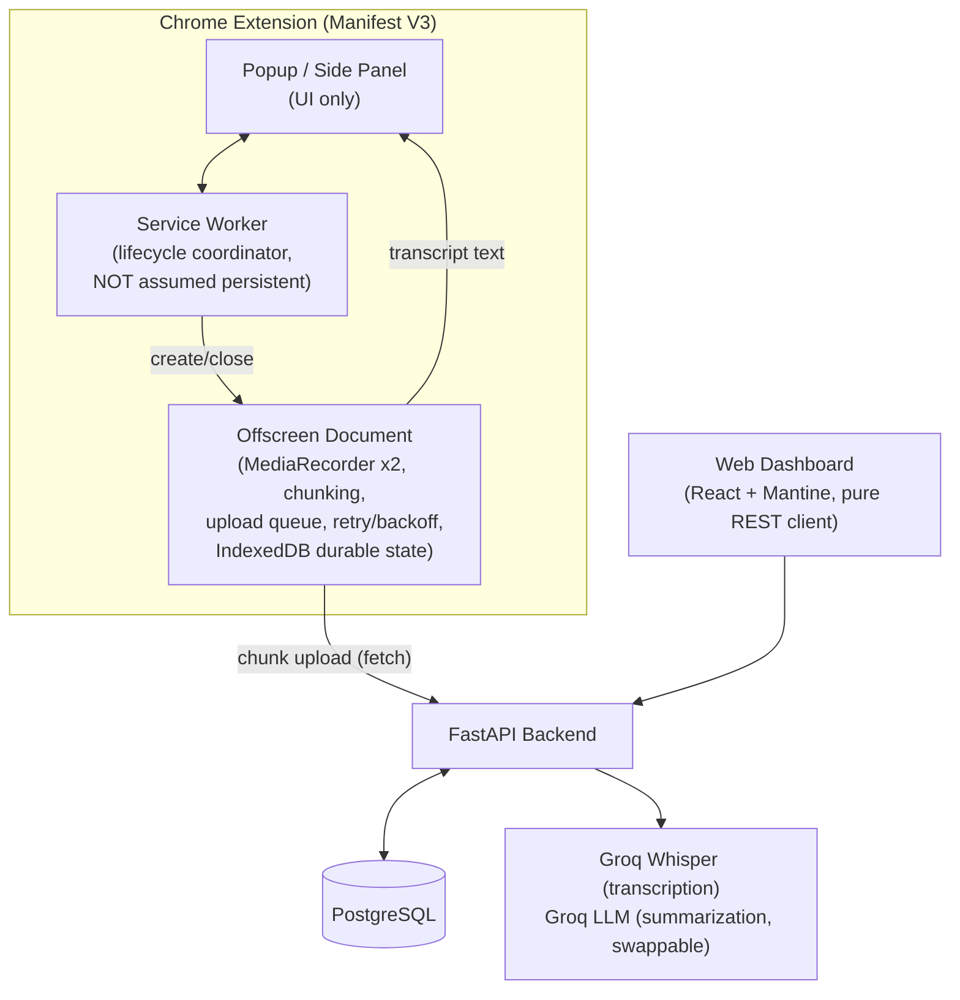
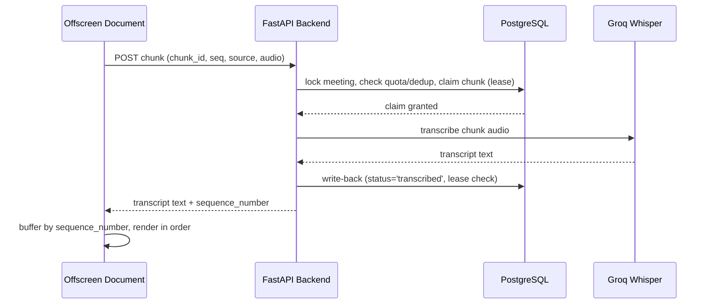
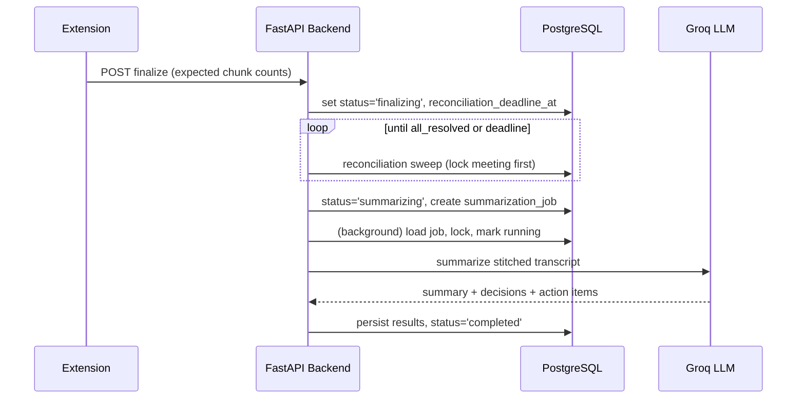

# Notelify AI — System Architecture

**Status:** APPROVED
**Last updated:** 2026-11-09

## Approach: Chunked REST Pipeline (approved)

Two alternative architectures were considered and rejected in favor of this one:

| Approach | Outcome | Why |
|---|---|---|
| **Chunked REST Pipeline** (this doc) | **Approved** | Fits local Docker Compose + extension-only live view; no queue/worker infra needed at v1 scale. |
| Queue-based pipeline (Redis/Celery, extension polls for results) | Rejected for v1, deferred to future scale phase | More resilient at high concurrency, but adds operational cost (Redis + worker process + polling latency) not needed yet. |
| Direct-to-provider from extension (extension calls Groq directly) | Rejected outright | Would leak the Groq API key into the extension, breaks per-user quota enforcement, and conflicts with the two-stream-merge requirement. |

The extension records tab audio and microphone audio as two parallel streams,
cut into ~7-second chunks. Each chunk is POSTed to the backend tied to a
`meeting_id`. The backend forwards it to Groq Whisper **inline, within the
same request**, persists the resulting transcript segment, and returns the
text directly in the HTTP response — the extension displays it immediately.
On "stop," the extension calls a finalize endpoint; once every accepted chunk
has reached a terminal state, a background task stitches the transcript and
calls a Groq-hosted LLM (behind a swappable provider interface) to produce
the summary, decisions, and action items. The web dashboard never talks to
Groq — it is a plain REST client over stored data.

## Components

### Responsibilities

- **Popup / Side Panel** — start/stop controls, live transcript display,
  upload-failure indicator. No audio handling of its own.
- **Service Worker (MV3, non-persistent — never assumed alive for the whole
  recording session)** — pure lifecycle coordinator: obtains the
  `tabCapture` stream ID after explicit user interaction, creates and closes
  the Offscreen Document, relays commands/status between popup and offscreen
  document, and recovers coordination state after its own restarts (reading
  persisted state rather than assuming continuity).
- **Offscreen Document** — owns all of: microphone capture (`getUserMedia`),
  tab audio capture (via the stream ID handed off by the service worker),
  both `MediaRecorder` instances, chunk generation, asynchronous chunk
  uploads (up to 3 concurrent in flight), upload retry/backoff, and durable
  IndexedDB-backed state (meeting ID, chunk IDs/sequence numbers, pending
  uploads, upload status/retry metadata, expected chunk counts per source).
  Full detail in `06-CHROME-EXTENSION-SPECIFICATION.md`.
- **FastAPI Backend** — authentication, quota enforcement, chunk ingestion,
  synchronous Groq Whisper calls, Postgres persistence, finalize/
  reconciliation orchestration, summarization job processing. Holds the only
  Groq credentials in the system.
- **PostgreSQL** — system of record for everything; also functions as the
  durable job queue for summarization (no separate queue infrastructure).
  Full schema in `04-DATABASE-DESIGN.md`.
- **Web Dashboard** — pure REST client over finalized/in-progress meeting
  data. No realtime channel to the backend.

## Chunk lifecycle

1. **Capture**: each stream's `MediaRecorder` is stopped/restarted every ~7s
   to produce a self-contained audio file per chunk. *Accepted trade-off*: a
   sub-200ms gap at each boundary, versus the added complexity of a lossless
   `AudioWorklet`-based continuous capture (deferred, not built in v1).
2. **Tag**: each chunk gets a client-generated UUID (`chunk_id`), a monotonic
   `sequence_number` per `(meeting_id, source)`, `source` (`tab`|`mic`), and
   `started_at`/`ended_at` timestamps anchored to meeting start.
3. **Upload**: the Offscreen Document POSTs chunks with up to 3 concurrent
   in-flight uploads, so a slow chunk never blocks the next recording
   segment.
4. **Retry**: failed uploads retry with exponential backoff (1s→16s, capped
   at 5 attempts client-side), then move to an IndexedDB-backed buffer with a
   manual-retry UI affordance.
5. **Server processing (synchronous)**: the backend validates ownership and
   quota, claims the chunk via an idempotent, lease-based mechanism, calls
   Groq Whisper inline, and returns the result in the HTTP response — so by
   the time the extension gets a response, that chunk is terminal
   server-side (barring a lease race, handled explicitly — see
   `04-DATABASE-DESIGN.md`).
6. **Ordering**: because concurrent chunks can resolve out of order, the
   popup buffers incoming transcript text by `sequence_number` per source and
   renders only contiguous runs.
7. **Finalize**: on stop, the extension flushes its failed-chunk buffer, then
   calls `finalize` with the expected chunk counts per source. The backend
   reconciles within a bounded window and only then runs summarization.
8. **Summarization**: a background task stitches all transcribed chunks
   chronologically by `started_at` (interleaving `tab`/`mic`), labels
   "me" vs. "meeting", and calls the LLM provider interface.

## Concurrency design — global invariant

Every meeting-scoped database transaction (chunk accept, chunk retry, Groq
result write-back, reconciliation sweep, finalize-request, summarization-job
creation) acquires locks in a single fixed order:

**meeting row → (user row, only when charging quota) → chunk row**

No transaction ever acquires a second meeting's lock, and the user lock is
only ever taken strictly after the meeting lock — so no lock-ordering cycle
can form; the design is deadlock-free by construction. Full transaction-level
detail, including the quota reservation, chunk idempotency/retry/lease
mechanics, and the reconciliation-deadline enforcement, is in
`04-DATABASE-DESIGN.md`.

## Deferred infrastructure (explicitly not in v1)

- Redis/Celery or any distributed task queue.
- Multiple backend worker processes (the summarization job lease mechanism
  is designed to extend to this later without a schema change, but v1 runs a
  single backend process).
- Multi-client real-time synchronization (dashboard watching a live
  transcript).
