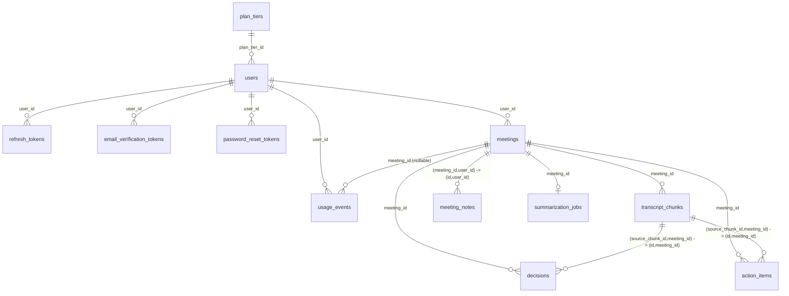

# Notelify AI — Database Design

**Status:** APPROVED (this is the final, reviewed schema and transaction
design after multiple correction rounds — see "Revision history" at the
bottom for what each round fixed)
**Last updated:** 2026-11-09
**Requires:** PostgreSQL 15+ (column-scoped `ON DELETE SET NULL (column)` on
composite foreign keys)

## Entity Relationship Diagram



## Final DDL

```sql
CREATE EXTENSION IF NOT EXISTS pgcrypto;
CREATE EXTENSION IF NOT EXISTS citext;

-- ===== Plan tiers (lookup table — new tiers are inserts, not migrations) =====
CREATE TABLE plan_tiers (
    id                       UUID PRIMARY KEY DEFAULT gen_random_uuid(),
    name                     VARCHAR(32) UNIQUE NOT NULL,
    quota_minutes_per_period INTEGER NOT NULL CHECK (quota_minutes_per_period > 0),
    is_active                BOOLEAN NOT NULL DEFAULT true,
    created_at               TIMESTAMPTZ NOT NULL DEFAULT now()
);
-- seed: INSERT INTO plan_tiers (name, quota_minutes_per_period) VALUES ('free', 300);

-- ===== Users =====
CREATE TABLE users (
    id                  UUID PRIMARY KEY DEFAULT gen_random_uuid(),
    email               CITEXT UNIQUE NOT NULL,
    password_hash       TEXT NOT NULL,
    email_verified_at   TIMESTAMPTZ,
    plan_tier_id        UUID NOT NULL REFERENCES plan_tiers(id) ON DELETE RESTRICT,
    quota_minutes_used  NUMERIC(10,2) NOT NULL DEFAULT 0 CHECK (quota_minutes_used >= 0),
    quota_period_start  DATE NOT NULL DEFAULT date_trunc('month', now() AT TIME ZONE 'UTC')::date,
    created_at          TIMESTAMPTZ NOT NULL DEFAULT now(),
    updated_at          TIMESTAMPTZ NOT NULL DEFAULT now()
);
-- quota_period_start is DATE, not TIMESTAMPTZ: only the UTC month-start date is
-- meaningful, and DATE has no timezone to get wrong.

CREATE TABLE refresh_tokens (
    id          UUID PRIMARY KEY DEFAULT gen_random_uuid(),
    user_id     UUID NOT NULL REFERENCES users(id) ON DELETE CASCADE,
    token_hash  TEXT NOT NULL,
    expires_at  TIMESTAMPTZ NOT NULL,
    revoked_at  TIMESTAMPTZ,
    created_at  TIMESTAMPTZ NOT NULL DEFAULT now()
);
CREATE INDEX idx_refresh_tokens_user ON refresh_tokens(user_id);
CREATE INDEX idx_refresh_tokens_hash ON refresh_tokens(token_hash);

CREATE TABLE email_verification_tokens (
    id           UUID PRIMARY KEY DEFAULT gen_random_uuid(),
    user_id      UUID NOT NULL REFERENCES users(id) ON DELETE CASCADE,
    token_hash   TEXT NOT NULL,
    expires_at   TIMESTAMPTZ NOT NULL,
    consumed_at  TIMESTAMPTZ,
    created_at   TIMESTAMPTZ NOT NULL DEFAULT now()
);
CREATE INDEX idx_email_verif_user ON email_verification_tokens(user_id);

CREATE TABLE password_reset_tokens (
    id           UUID PRIMARY KEY DEFAULT gen_random_uuid(),
    user_id      UUID NOT NULL REFERENCES users(id) ON DELETE CASCADE,
    token_hash   TEXT NOT NULL,
    expires_at   TIMESTAMPTZ NOT NULL,
    consumed_at  TIMESTAMPTZ,
    created_at   TIMESTAMPTZ NOT NULL DEFAULT now()
);
CREATE INDEX idx_pw_reset_user ON password_reset_tokens(user_id);
-- Cleanup: no DB-enforced purge. A daily scheduled job deletes rows from all
-- three token tables where expires_at < now() - interval '30 days', to keep
-- tables small. Expired-but-unpurged tokens are already unusable since
-- expiry is checked at auth time, independent of purging.

-- ===== Meetings =====
CREATE TYPE meeting_status AS ENUM ('recording','finalizing','summarizing','completed','failed');

CREATE TABLE meetings (
    id                          UUID PRIMARY KEY DEFAULT gen_random_uuid(),
    user_id                     UUID NOT NULL REFERENCES users(id) ON DELETE CASCADE,
    title                       TEXT,
    status                      meeting_status NOT NULL DEFAULT 'recording',
    started_at                  TIMESTAMPTZ NOT NULL DEFAULT now(),
    ended_at                    TIMESTAMPTZ,
    finalize_requested_at       TIMESTAMPTZ,
    expected_tab_chunks         INTEGER CHECK (expected_tab_chunks IS NULL OR expected_tab_chunks >= 0),
    expected_mic_chunks         INTEGER CHECK (expected_mic_chunks IS NULL OR expected_mic_chunks >= 0),
    reconciliation_deadline_at  TIMESTAMPTZ,
    finalization_completed_at   TIMESTAMPTZ,
    quota_exceeded_at           TIMESTAMPTZ,
    failure_reason              TEXT,
    summary_text                TEXT,
    summary_structured          JSONB,
    summary_schema_version      INTEGER NOT NULL DEFAULT 1,
    summary_model               TEXT,
    summarized_at               TIMESTAMPTZ,
    created_at                  TIMESTAMPTZ NOT NULL DEFAULT now(),
    updated_at                  TIMESTAMPTZ NOT NULL DEFAULT now(),
    CHECK (ended_at IS NULL OR ended_at >= started_at),
    CHECK ((expected_tab_chunks IS NULL) = (expected_mic_chunks IS NULL)),
    UNIQUE (id, user_id)
);
CREATE INDEX idx_meetings_user_history ON meetings(user_id, started_at DESC);

-- ===== Transcript chunks =====
CREATE TYPE chunk_status AS ENUM ('processing','transcribed','failed');
CREATE TYPE chunk_source AS ENUM ('tab','mic');

CREATE TABLE transcript_chunks (
    id              UUID PRIMARY KEY DEFAULT gen_random_uuid(),
    meeting_id      UUID NOT NULL REFERENCES meetings(id) ON DELETE CASCADE,
    source          chunk_source NOT NULL,
    chunk_id        UUID NOT NULL,              -- client-generated
    sequence_number INTEGER NOT NULL CHECK (sequence_number >= 0),
    status          chunk_status NOT NULL DEFAULT 'processing',
    text            TEXT,
    error_message   TEXT,
    attempt_count   INTEGER NOT NULL DEFAULT 1 CHECK (attempt_count >= 0),
    max_attempts    INTEGER NOT NULL DEFAULT 3 CHECK (max_attempts > 0),
    is_exhausted    BOOLEAN GENERATED ALWAYS AS (
                        status = 'failed' AND attempt_count >= max_attempts
                    ) STORED,
    locked_by       TEXT NOT NULL,               -- fresh UUID per claim attempt, not a stable worker id
    locked_until    TIMESTAMPTZ NOT NULL,
    last_attempt_at TIMESTAMPTZ NOT NULL DEFAULT now(),
    started_at      TIMESTAMPTZ NOT NULL,
    ended_at        TIMESTAMPTZ NOT NULL,
    received_at     TIMESTAMPTZ NOT NULL DEFAULT now(),
    processed_at    TIMESTAMPTZ,
    updated_at      TIMESTAMPTZ NOT NULL DEFAULT now(),
    CHECK (ended_at > started_at),
    UNIQUE (meeting_id, source, chunk_id),
    UNIQUE (meeting_id, source, sequence_number),
    UNIQUE (id, meeting_id)
);
CREATE INDEX idx_chunks_order ON transcript_chunks(meeting_id, source, sequence_number);
CREATE INDEX idx_chunks_unresolved ON transcript_chunks(meeting_id)
    WHERE status != 'transcribed' AND NOT is_exhausted;

-- ===== Usage events (append-only audit + billing) =====
CREATE TABLE usage_events (
    id               UUID PRIMARY KEY DEFAULT gen_random_uuid(),
    user_id          UUID NOT NULL REFERENCES users(id) ON DELETE CASCADE,
    meeting_id       UUID REFERENCES meetings(id) ON DELETE SET NULL,
    chunk_id         UUID NOT NULL,
    source           chunk_source NOT NULL,
    duration_seconds NUMERIC(8,2) NOT NULL CHECK (duration_seconds >= 0),
    billable_seconds NUMERIC(8,2) NOT NULL DEFAULT 0 CHECK (billable_seconds >= 0),
    created_at       TIMESTAMPTZ NOT NULL DEFAULT now(),
    UNIQUE (user_id, meeting_id, source, chunk_id)
);
CREATE INDEX idx_usage_events_user_time ON usage_events(user_id, created_at);

-- ===== Summarization jobs =====
CREATE TYPE job_status AS ENUM ('pending','running','succeeded','failed');

CREATE TABLE summarization_jobs (
    id              UUID PRIMARY KEY DEFAULT gen_random_uuid(),
    meeting_id      UUID NOT NULL UNIQUE REFERENCES meetings(id) ON DELETE CASCADE,
    status          job_status NOT NULL DEFAULT 'pending',
    attempts        INTEGER NOT NULL DEFAULT 0 CHECK (attempts >= 0),
    max_attempts    INTEGER NOT NULL DEFAULT 5 CHECK (max_attempts > 0),
    next_attempt_at TIMESTAMPTZ NOT NULL DEFAULT now(),
    locked_by       TEXT,
    locked_until    TIMESTAMPTZ,
    last_error      TEXT,
    started_at      TIMESTAMPTZ,
    completed_at    TIMESTAMPTZ,
    created_at      TIMESTAMPTZ NOT NULL DEFAULT now(),
    updated_at      TIMESTAMPTZ NOT NULL DEFAULT now()
);
CREATE INDEX idx_jobs_scheduler ON summarization_jobs(status, next_attempt_at);

-- ===== Decisions / Action items (optional transcript evidence) =====
CREATE TABLE decisions (
    id               UUID PRIMARY KEY DEFAULT gen_random_uuid(),
    meeting_id       UUID NOT NULL REFERENCES meetings(id) ON DELETE CASCADE,
    text             TEXT NOT NULL,
    evidence_excerpt TEXT,
    source_chunk_id  UUID,
    order_index      INTEGER NOT NULL,
    created_at       TIMESTAMPTZ NOT NULL DEFAULT now(),
    FOREIGN KEY (source_chunk_id, meeting_id) REFERENCES transcript_chunks(id, meeting_id)
        ON DELETE SET NULL (source_chunk_id)
);
CREATE INDEX idx_decisions_meeting ON decisions(meeting_id);

CREATE TYPE action_item_status AS ENUM ('open','done');

CREATE TABLE action_items (
    id               UUID PRIMARY KEY DEFAULT gen_random_uuid(),
    meeting_id       UUID NOT NULL REFERENCES meetings(id) ON DELETE CASCADE,
    text             TEXT NOT NULL,
    owner            TEXT,
    due_date         DATE,
    status           action_item_status NOT NULL DEFAULT 'open',
    evidence_excerpt TEXT,
    source_chunk_id  UUID,
    order_index      INTEGER NOT NULL,
    created_at       TIMESTAMPTZ NOT NULL DEFAULT now(),
    FOREIGN KEY (source_chunk_id, meeting_id) REFERENCES transcript_chunks(id, meeting_id)
        ON DELETE SET NULL (source_chunk_id)
);
CREATE INDEX idx_action_items_meeting ON action_items(meeting_id);

-- ===== Meeting notes (ownership tied to the meeting via composite FK) =====
CREATE TABLE meeting_notes (
    id          UUID PRIMARY KEY DEFAULT gen_random_uuid(),
    meeting_id  UUID NOT NULL,
    user_id     UUID NOT NULL,
    content     TEXT NOT NULL,
    created_at  TIMESTAMPTZ NOT NULL DEFAULT now(),
    updated_at  TIMESTAMPTZ NOT NULL DEFAULT now(),
    FOREIGN KEY (meeting_id, user_id) REFERENCES meetings(id, user_id) ON DELETE CASCADE
);
CREATE INDEX idx_meeting_notes_meeting ON meeting_notes(meeting_id);
```

### Ownership-integrity design notes

- `meetings` carries `UNIQUE (id, user_id)`; `meeting_notes` references it
  via a **composite** FK `(meeting_id, user_id) → meetings(id, user_id)`
  instead of two independent FKs — the database cannot physically store a
  note whose `user_id` disagrees with its meeting's owner.
- `transcript_chunks` carries `UNIQUE (id, meeting_id)`; `decisions` and
  `action_items` reference it via composite FK `(source_chunk_id,
  meeting_id) → transcript_chunks(id, meeting_id)` — a decision/action item
  cannot cite a chunk belonging to a different meeting. Since
  `source_chunk_id` is nullable, Postgres's default composite-FK semantics
  skip the check whenever either column is `NULL`, so this is only enforced
  once an evidence link is actually set.
- The composite FKs' delete action uses column-scoped
  `ON DELETE SET NULL (source_chunk_id)` (Postgres 15+) so deleting a chunk
  nulls only the evidence link, never the required `meeting_id`.

## Deletion & retention behavior

| Table | On parent delete | Rationale |
|---|---|---|
| `meetings` (user deleted) | CASCADE | Right-to-be-forgotten: deleting an account removes all meeting content. |
| `transcript_chunks`, `decisions`, `action_items`, `meeting_notes`, `summarization_jobs` (meeting deleted) | CASCADE | Meaningless without their parent meeting. |
| `usage_events` (meeting deleted) | SET NULL on `meeting_id` | Billing/audit rows outlive meeting-content deletion; `user_id` still cascades if the whole account is deleted. |
| `refresh_tokens`, `email_verification_tokens`, `password_reset_tokens` (user deleted) | CASCADE | Pure auth artifacts, no independent retention need. |
| `users.plan_tier_id` (tier deleted) | RESTRICT | Tiers are soft-deactivated (`is_active=false`), never hard-deleted while users reference them. |
| `decisions.source_chunk_id`, `action_items.source_chunk_id` (chunk deleted) | SET NULL (column-scoped) | Defensive only — chunks are only ever deleted via meeting cascade, which deletes these rows too. |

Deleting a `meetings` row is a **hard delete** — there is no soft-delete/trash
in v1.

## Concurrency design

### Global lock-ordering invariant

Every meeting-scoped transaction below acquires locks in exactly this order,
with no exceptions anywhere in the design:

**meeting row (`SELECT ... FOR UPDATE` on `meetings.id`) → user row (only
when charging quota) → chunk row**

Because no transaction ever needs a second meeting's lock, and the user lock
is only ever taken after the meeting lock, no lock-ordering cycle can form —
the design is deadlock-free by construction, not by coincidence. A corollary:
every meeting-scoped transaction for the *same* `meeting_id` is fully
serialized against every other one — chunk accept/retry, Groq write-back, the
reconciliation sweep, and finalize/job-creation can never interleave for a
given meeting.

### Atomic monthly quota reset (folded into the charge statement)

A separate "check and reset" step would reopen a race (two concurrent tab
chunks both observing a stale period and both resetting). The reset is
computed inside the same row-locked `UPDATE` that applies the charge:

```sql
WITH current_period AS (
  SELECT date_trunc('month', now() AT TIME ZONE 'UTC')::date AS month_start
)
UPDATE users
SET quota_minutes_used = CASE
      WHEN users.quota_period_start < current_period.month_start THEN :inc
      ELSE users.quota_minutes_used + :inc
    END,
    quota_period_start = current_period.month_start,
    updated_at = now()
FROM current_period
WHERE users.id = :user_id
  AND (CASE WHEN users.quota_period_start < current_period.month_start THEN :inc
            ELSE users.quota_minutes_used + :inc
       END) <= (SELECT quota_minutes_per_period FROM plan_tiers WHERE id = users.plan_tier_id)
RETURNING users.quota_minutes_used, users.quota_period_start;
```

`quota_period_start = current_period.month_start` is written unconditionally
but is a no-op when no reset was due. The row-level lock this `UPDATE` takes
on the `users` row serializes concurrent charges for the same user: whichever
commits first performs the reset (if due); the second re-evaluates against
the *already-committed* value and can never double-reset or charge against a
stale baseline.

**Billing design**: only `tab`-source chunks carry `billable_seconds > 0`
(the tab is open only for the meeting's actual duration, making it the
canonical billing signal). `mic` chunks always log `billable_seconds = 0` —
audited, never billed. **Known, accepted limitation**: a meeting whose every
`tab` chunk fails bills as zero minutes even if mic audio was captured. A
meeting straddling a UTC month boundary may bill partly against the old
period and partly the new; a `quota_exceeded_at` already set on a meeting is
never cleared by the reset (it's meeting-scoped, not period-scoped) — only a
*new* meeting benefits from the reset.

### Transaction Flow 1 — New tab chunk

```sql
BEGIN;
SELECT status, quota_exceeded_at, reconciliation_deadline_at
FROM meetings WHERE id = :meeting_id FOR UPDATE;

-- (Existence of this chunk_id has already been rechecked under this lock —
-- see "Unified chunk accept/retry dispatch" below. This block runs only on
-- the genuinely-new-chunk branch, with status IN ('recording','finalizing')
-- and the reconciliation deadline not yet passed, and quota_exceeded_at NULL.)

WITH charge AS (
  INSERT INTO usage_events (user_id, meeting_id, chunk_id, source, duration_seconds, billable_seconds)
  VALUES (:user_id, :meeting_id, :chunk_id, 'tab', :duration_seconds, :duration_seconds)
  RETURNING billable_seconds
), current_period AS (
  SELECT date_trunc('month', now() AT TIME ZONE 'UTC')::date AS month_start
)
UPDATE users
SET quota_minutes_used = CASE
      WHEN users.quota_period_start < current_period.month_start
        THEN (SELECT billable_seconds FROM charge) / 60.0
      ELSE users.quota_minutes_used + (SELECT billable_seconds FROM charge) / 60.0
    END,
    quota_period_start = current_period.month_start,
    updated_at = now()
FROM current_period
WHERE users.id = :user_id
  AND (CASE WHEN users.quota_period_start < current_period.month_start
            THEN (SELECT billable_seconds FROM charge) / 60.0
            ELSE users.quota_minutes_used + (SELECT billable_seconds FROM charge) / 60.0
       END) <= (SELECT quota_minutes_per_period FROM plan_tiers WHERE id = users.plan_tier_id)
RETURNING users.quota_minutes_used;

-- Charge accepted (row returned):
INSERT INTO transcript_chunks (
  meeting_id, source, chunk_id, sequence_number, status,
  attempt_count, max_attempts, locked_by, locked_until, last_attempt_at, started_at, ended_at
) VALUES (
  :meeting_id, 'tab', :chunk_id, :sequence_number, 'processing',
  1, 3, :lease_token, now() + interval '30 seconds', now(), :started_at, :ended_at
);
COMMIT;
-- -> call Groq now, OUTSIDE this transaction.

-- Charge rejected (no row returned) -- this branch runs INSTEAD of the one above:
DELETE FROM usage_events WHERE user_id = :user_id AND meeting_id = :meeting_id
  AND source = 'tab' AND chunk_id = :chunk_id;   -- remove the orphaned charge attempt

UPDATE meetings SET quota_exceeded_at = now()
WHERE id = :meeting_id AND quota_exceeded_at IS NULL;

INSERT INTO transcript_chunks (
  meeting_id, source, chunk_id, sequence_number, status,
  attempt_count, max_attempts, locked_by, locked_until, last_attempt_at, started_at, ended_at, error_message
) VALUES (
  :meeting_id, 'tab', :chunk_id, :sequence_number, 'failed',
  3, 3, :lease_token, now(), now(), :started_at, :ended_at, 'quota_exceeded'
);
COMMIT;
-- No Groq call.
```

### Transaction Flow 2 — New microphone chunk

```sql
BEGIN;
SELECT status, quota_exceeded_at, reconciliation_deadline_at
FROM meetings WHERE id = :meeting_id FOR UPDATE;

-- quota_exceeded_at IS NULL, status/deadline OK -> mic never charges quota,
-- just an audit row (billable_seconds = 0) + claim:
INSERT INTO usage_events (user_id, meeting_id, chunk_id, source, duration_seconds, billable_seconds)
VALUES (:user_id, :meeting_id, :chunk_id, 'mic', :duration_seconds, 0);

INSERT INTO transcript_chunks (
  meeting_id, source, chunk_id, sequence_number, status,
  attempt_count, max_attempts, locked_by, locked_until, last_attempt_at, started_at, ended_at
) VALUES (
  :meeting_id, 'mic', :chunk_id, :sequence_number, 'processing',
  1, 3, :lease_token, now() + interval '30 seconds', now(), :started_at, :ended_at
);
COMMIT;
-- -> call Groq now, outside the transaction.

-- If quota_exceeded_at IS NOT NULL (or status/deadline fail): same rejection
-- shape as Flow 4, no usage_events row at all -- nothing was processed.
```

### Transaction Flow 3 — Existing chunk retry (tab or mic, identical treatment)

```sql
BEGIN;
SELECT status, quota_exceeded_at, reconciliation_deadline_at
FROM meetings WHERE id = :meeting_id FOR UPDATE;
-- Lock taken for serialization; its value is consulted only for the
-- meeting-closed / deadline-passed guards below -- an EXISTING chunk is
-- otherwise exempt from the quota gate entirely (see rationale below).

SELECT status, attempt_count, max_attempts, locked_until, text, error_message
FROM transcript_chunks
WHERE meeting_id = :meeting_id AND source = :source AND chunk_id = :chunk_id;

-- status = 'transcribed'                         -> COMMIT (no-op); return cached `text`. Always
--                                                     allowed, regardless of meeting status/deadline.
-- meeting status NOT IN ('recording','finalizing') -> COMMIT (no-op); return current state as-is,
--                                                     no claim attempt (chunk may still not be
--                                                     'transcribed' -- that's fine, it's returned as-is).
-- deadline has passed (status='finalizing')        -> COMMIT (no-op); return current state as-is,
--                                                     no claim attempt, even if attempts remain.
-- status = 'processing', lease live                -> COMMIT (no-op); return "still processing".
-- status = 'failed', attempts exhausted            -> COMMIT (no-op); return terminal failure.

-- Otherwise -- status='failed' with attempts left, OR status='processing' with
-- an expired lease, AND meeting is 'recording' or 'finalizing'-before-deadline:
UPDATE transcript_chunks
SET status = 'processing', locked_by = :lease_token, locked_until = now() + interval '30 seconds',
    attempt_count = attempt_count + 1, last_attempt_at = now()
WHERE meeting_id = :meeting_id AND source = :source AND chunk_id = :chunk_id
  AND (status = 'failed' OR (status = 'processing' AND locked_until < now()))
  AND attempt_count < max_attempts
RETURNING id, attempt_count;
COMMIT;
-- Row returned -> this request holds the lease; call Groq now, outside the transaction.
-- No row returned -> lost a race to a concurrent claimer; re-read and respond accordingly.
```

No `usage_events`/`users` statement appears anywhere in this flow — the
mechanism that guarantees an already-accepted chunk is never charged twice,
and that quota exhaustion never destroys or blocks recovery of previously
accepted work (tab or mic alike).

### Transaction Flow 4 — Quota-exceeded (or closed-meeting / deadline-passed) rejection of a brand-new chunk

```sql
BEGIN;
SELECT status, quota_exceeded_at, reconciliation_deadline_at
FROM meetings WHERE id = :meeting_id FOR UPDATE;
-- No transcript_chunks row exists yet for this chunk_id (confirmed under this lock).

INSERT INTO transcript_chunks (
  meeting_id, source, chunk_id, sequence_number, status,
  attempt_count, max_attempts, locked_by, locked_until, last_attempt_at, started_at, ended_at, error_message
) VALUES (
  :meeting_id, :source, :chunk_id, :sequence_number, 'failed',
  3, 3, :lease_token, now(), now(), :started_at, :ended_at,
  :reason  -- 'quota_exceeded' | 'meeting_closed' | 'reconciliation_timeout', as applicable
)
ON CONFLICT (meeting_id, source, chunk_id) DO NOTHING;
-- DO NOTHING guards a same-instant duplicate new-chunk race; whichever insert
-- wins stands. Applies identically to tab and mic. No usage_events row is
-- written -- nothing was processed, nothing to audit.
COMMIT;
```

### Unified chunk accept/retry dispatch (ties Flows 1-4 together)

The decisive existence check for "is this chunk new?" happens **after** the
meeting lock is acquired, not before — an earlier, unlocked pre-check (if the
app performs one as a fast-path hint) is advisory only and is never the final
decision. This is what prevents two simultaneous requests for the same
brand-new `chunk_id` from both deciding "new" and racing into the charge
path:

```sql
BEGIN;
SELECT status, quota_exceeded_at, reconciliation_deadline_at
FROM meetings WHERE id = :meeting_id FOR UPDATE;

-- deadline_passed := status = 'finalizing' AND reconciliation_deadline_at IS NOT NULL
--                     AND now() >= reconciliation_deadline_at

SELECT id, status, attempt_count, max_attempts, locked_until, text, error_message
FROM transcript_chunks
WHERE meeting_id = :meeting_id AND source = :source AND chunk_id = :chunk_id;

-- Branch A: row EXISTS -> Flow 3's dispatch, exactly as written there.
-- Branch B: row does NOT exist (new, confirmed under THIS lock) ->
--   status NOT IN ('recording','finalizing') -> Flow 4, reason='meeting_closed'
--   deadline_passed                            -> Flow 4, reason='reconciliation_timeout'
--   quota_exceeded_at IS NOT NULL               -> Flow 4, reason='quota_exceeded'
--   otherwise -> Flow 1 (tab) or Flow 2 (mic)
COMMIT;
```

**A delayed upload never extends the reconciliation window**:
`reconciliation_deadline_at` is written in exactly one place — the
finalize-request transaction, once. No chunk accept/retry/write-back path
ever assigns it.

### Groq result write-back (success and failure)

Runs as its own short transaction, **after** the Groq HTTP call completes —
the Groq call itself must never happen inside an open database transaction.

```sql
BEGIN;
SELECT status, reconciliation_deadline_at FROM meetings WHERE id = :meeting_id FOR UPDATE;

-- status NOT IN ('recording','finalizing')                                  -> DISCARD, COMMIT (no-op).
-- status = 'finalizing' AND reconciliation_deadline_at IS NOT NULL
--   AND now() >= reconciliation_deadline_at                                 -> DISCARD, COMMIT (no-op).
--   (Rejected here even if the reconciliation sweep hasn't physically swept
--   this row yet -- the deadline is evaluated fresh, under this lock.)
-- otherwise -> proceed:

-- Success:
UPDATE transcript_chunks
SET status = 'transcribed', text = :transcript_text, processed_at = now(), updated_at = now()
WHERE id = :chunk_row_id AND status = 'processing' AND locked_by = :lease_token
RETURNING id;
-- 0 rows => superseded by a concurrent retry claim -- discarded as an expected no-op.

-- Failure (transient Groq error on this attempt, not necessarily exhausted):
UPDATE transcript_chunks
SET status = 'failed', error_message = :error_message, processed_at = now(), updated_at = now()
WHERE id = :chunk_row_id AND status = 'processing' AND locked_by = :lease_token
RETURNING id;
-- is_exhausted is computed automatically from attempt_count vs max_attempts;
-- if this was the last allowed attempt it becomes terminal immediately,
-- otherwise it's eligible for another retry-claim via Flow 3.

COMMIT;
```

**Preserved behavior**: a response arriving after its 30-second lease has
numerically expired still succeeds if (a) nobody has reclaimed the chunk
(`locked_by` still matches) and (b) the meeting hasn't moved on and the
deadline hasn't passed. Lease expiry means "available to be reclaimed," not
"automatically invalid."

Because the meeting-row lock is acquired first here too, write-back can never
interleave with the reconciliation sweep for the same meeting — one fully
commits before the other starts.

### Transaction Flow 5 — Finalization and reconciliation

```sql
-- On "stop" request from the client:
BEGIN;
UPDATE meetings
SET status = 'finalizing', finalize_requested_at = now(),
    expected_tab_chunks = :expected_tab_chunks, expected_mic_chunks = :expected_mic_chunks,
    reconciliation_deadline_at = now() + interval '60 seconds'
WHERE id = :meeting_id AND status = 'recording';
COMMIT;
-- 0 rows affected => finalize already in progress; fetch and return current
-- state instead of restarting the process (idempotent).

-- Reconciliation sweep -- runs on each chunk completion and on a periodic timeout check:
BEGIN;
SELECT status, reconciliation_deadline_at FROM meetings WHERE id = :meeting_id FOR UPDATE;

UPDATE transcript_chunks
SET status = 'failed', error_message = COALESCE(error_message, 'max_attempts_exceeded')
WHERE meeting_id = :meeting_id AND status = 'processing'
  AND locked_until < now() AND attempt_count >= max_attempts;
-- Only resolves leases that have ACTUALLY expired with no attempts left; a
-- live final attempt is never touched here.

SELECT NOT EXISTS (
  SELECT 1 FROM transcript_chunks
  WHERE meeting_id = :meeting_id AND status != 'transcribed' AND NOT is_exhausted
) AS all_resolved;
COMMIT;

-- If all_resolved = true -> skip directly to job creation below.
-- If all_resolved = false AND now() < reconciliation_deadline_at -> wait for
--   the next trigger (another chunk completing, or the next periodic check).
-- If all_resolved = false AND now() >= reconciliation_deadline_at -> force
--   resolution, deliberately abandoning anything still in flight:
BEGIN;
SELECT status, reconciliation_deadline_at FROM meetings WHERE id = :meeting_id FOR UPDATE;
UPDATE transcript_chunks
SET status = 'failed', attempt_count = max_attempts,
    error_message = COALESCE(error_message, 'reconciliation_timeout')
WHERE meeting_id = :meeting_id AND status != 'transcribed' AND NOT is_exhausted;
-- attempt_count is explicitly set to max_attempts here -- without this, a
-- chunk force-failed while retries remained would have is_exhausted = false
-- forever, permanently blocking all_resolved. This was corrected after
-- review; see revision history.
-- This intentionally overrides even a LIVE lease once the bounded window has
-- elapsed. A Groq response arriving after this point for such a chunk is
-- discarded by the write-back's own guard as a no-op (see above).
COMMIT;

-- Job creation (reached only once all_resolved = true, naturally or by forced timeout):
BEGIN;
SELECT status FROM meetings WHERE id = :meeting_id FOR UPDATE;
UPDATE meetings
SET status = 'summarizing', finalization_completed_at = now()
WHERE id = :meeting_id AND status = 'finalizing';

INSERT INTO summarization_jobs (meeting_id, status, next_attempt_at)
VALUES (:meeting_id, 'pending', now())
ON CONFLICT (meeting_id) DO NOTHING;
-- The ON CONFLICT guarantees exactly one job row per meeting even if this
-- block is reached concurrently from two triggers (a chunk-completion
-- callback and a timeout check landing at the same moment) -- this is the
-- "final conditional job-creation SQL correction" referenced in the project
-- instructions.
COMMIT;
```

This closes the loop deliberately: summarization never starts while a chunk
is genuinely still running *within* the bounded window, but the window is a
hard bound — past it, remaining work is explicitly and visibly abandoned
(`reconciliation_timeout`), never silently ignored.

### Summarization job lifecycle (no Celery — the Postgres row is the queue)

- **Claim**: `UPDATE summarization_jobs SET status='running', locked_by=:worker_id, locked_until=now()+interval '2 minutes', started_at=now(), attempts=attempts+1 WHERE id=:id AND status='pending' AND next_attempt_at <= now() AND attempts < max_attempts RETURNING *`. The atomic `UPDATE ... WHERE` is itself the lock.
- **Success**: `status='succeeded', completed_at=now()`.
- **Transient failure (attempts left)**: back to `status='pending'`, lease cleared, `next_attempt_at = now() + backoff(attempts)`.
- **Exhausted**: `status='failed'`; also sets `meetings.status='failed', failure_reason='summarization_failed: ...'`.
- **Startup recovery**: `UPDATE summarization_jobs SET status='pending', locked_by=NULL, locked_until=NULL WHERE status='running' AND locked_until < now()` reclaims jobs orphaned by a crash, before a scheduler loop resumes polling.

## Alembic migration sequence

1. `0001_enable_extensions` — `pgcrypto`, `citext`
2. `0002_plan_tiers` — create table, seed `free` row
3. `0003_users_and_auth` — `users`, `refresh_tokens`, `email_verification_tokens`, `password_reset_tokens`
4. `0004_meetings` — `meeting_status` enum, `meetings` table (including `quota_exceeded_at`, `summary_schema_version`)
5. `0005_transcript_chunks` — `chunk_status`, `chunk_source` enums, `transcript_chunks` table (lease columns `NOT NULL`, `is_exhausted` generated column, full constraint set)
6. `0006_usage_events` — including the `source`-inclusive unique constraint
7. `0007_summarization_jobs` — `job_status` enum, lease/retry columns
8. `0008_decisions_and_action_items` — `action_item_status` enum, composite FKs to `transcript_chunks`
9. `0009_meeting_notes` — composite FK to `meetings`

Each migration is additive-only (no column drops/renames) and applies
cleanly to an empty database.

## Documented assumptions / known limitations

- Tab-only billing: a meeting with zero surviving `tab` chunks bills as 0
  minutes even if mic audio was captured.
- No quota refund when a charged chunk's transcription ultimately fails —
  duration is billed on acceptance, not on transcription success.
- A meeting spanning a UTC month boundary may bill partly against the old
  period, partly the new; a pre-reset `quota_exceeded_at` on that meeting is
  never cleared by the reset.
- Rejected chunks (`quota_exceeded`, `meeting_closed`, `reconciliation_timeout`)
  get no `usage_events` row — nothing was processed, nothing to audit.
- Client-supplied `started_at`/`ended_at` timestamps (used for billing
  duration and ordering) are trusted as-is; no clock-skew correction against
  the server's clock.
- Constants not yet product-validated: chunk lease duration (30s), chunk
  `max_attempts` (3), reconciliation deadline (60s), job `max_attempts` (5).

## Revision history (what each review round fixed)

1. **Initial schema** — core tables, basic FKs/enums.
2. **Ownership integrity, chunk concurrency, quota atomicity, UTC period,
   minor fixes** — composite FKs for ownership, lease columns added,
   `quota_period_start` moved to `DATE`, `summary_schema_version` added.
3. **Quota strict `<=`, initial-claim lease bug, retry-limit enforcement** —
   fixed new chunks being inserted `'processing'` with `NULL` lease (made
   `locked_by`/`locked_until` `NOT NULL`); (incorrectly, at this point)
   redefined `is_exhausted` to ignore `status`.
4. **Prevent reprocessing `transcribed` chunks, correct terminal detection,
   backend-enforced quota for both sources** — fixed the retry `WHERE` to
   exclude `transcribed` explicitly; reverted `is_exhausted` to require
   `status='failed'` (round 3's version wrongly treated an active final
   attempt as already resolved); added `meetings.quota_exceeded_at` with a
   meeting-level lock gating both sources.
5. **Column restoration confirmation, preserve previously-accepted chunks
   after quota exhaustion, full transaction atomicity, Groq stale-write
   protection** — made the quota gate apply only to genuinely new chunks
   (existing chunks always recover regardless of `quota_exceeded_at`);
   defined the exact lease-based write-back guard.
6. **Reconciliation deadline enforcement at accept/retry and at write-back**
   — added `deadline_passed` to the unified dispatch; moved write-back from
   an unlocked `EXISTS` check to the same meeting-lock-first pattern as every
   other flow, and fixed the deadline-forced sweep to set
   `attempt_count = max_attempts` (without this, a forced-failed chunk could
   never become `is_exhausted`, permanently blocking `all_resolved`).
